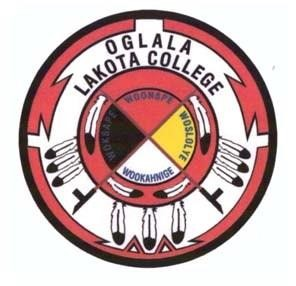
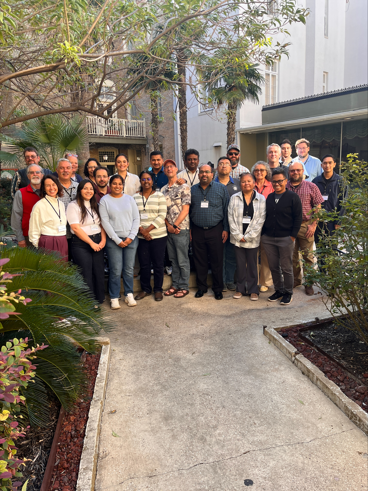
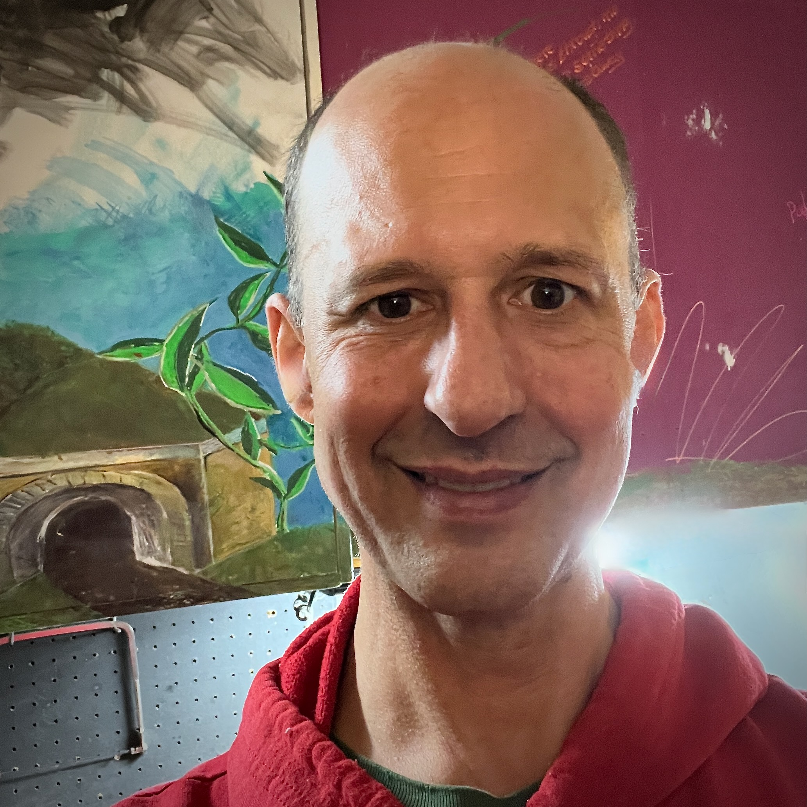

  
  &nbsp;&nbsp;
  

# Syllabus - TCUP Hub Training 2026

Welcome to the NSF TCUP Hub training 2026, led by the Environmental Data Science Innovation and Impact Lab
(<a href="https://esiil.org/" target="_blank">**ESIIL**</a>). We are excited to have you in class for the next 2 days as we introduce
you to **Earth and Environmental Data Science (EDS)** fundamentals using
<a href="https://www.github.com/" target="_blank">**GitHub**</a> and
<a href="https://www.python.org/" target="_blank">**Python**</a>.

This is our first workshop through the TCUP Hub and ESIIL and we're glad to be here
with you all as the first cohort of participants. This program is funded by the
**National Science Foundation**, with support from Oglala Lakota College's
**Thokatakiya** project
(<a href="https://www.nsf.gov/awardsearch/showAward?AWD_ID=2225573" target="_blank">**NSF Award # 2225573**</a>).

> ### These TCUP Hub and ESIIL data science workshops aim to meet the following objectives through technical training and applied learning:
>
> - Train the **next generation** of Earth and Environmental Data Science educators
> - Answer relevant **Earth/Environmental science** questions
> - **Develop Pathways** into the EDS workforce
> - **Build capacity** to teach & learn EDS

ESIIL is a part of the Cooperative Institute for Research in Environmental
Sciences (<a href="https://cires.colorado.edu/" target="_blank">**CIRES**</a>) a
partnership of the
<a href="https://www.colorado.edu/" target="_blank">**University of Colorado
Boulder**</a> and the National Oceanic and Atmospheric Administration
(<a href="https://www.noaa.gov/" target="_blank">**NOAA**</a>). We are also
affiliated with <a href="https://earthlab.colorado.edu/" target="_blank">**Earth
Lab**</a>.

We appreciate these partnerships and look forward to working with you all!

# Meet Our Team

### **Nate Quarderer**

- Education Director - Earth Lab; ESIIL
- <a href = "mailto: naqu1888@colorado.edu" target="_blank">**Email** </a>
- <a href = "https://earthlab.colorado.edu/our-team/nathan-quarderer" target="_blank">**Website**</a>

---

### **Charles Jason Tinant**

- Professor - Oglala Lakota College
- <a href="mailto:jtinant@olc.edu" target = "_blank">**Email**</a>
- <a href="https://cjtinant.github.io/" target="_blank">**Website**</a>

---

### **Brian Yandell**

- Professor Emeritus - University of Wisconsin Madison
- <a href="mailto: brian.yandell@wisc.edu" target = "_blank">**Email**</a>
- <a href="https://byandell.github.io/" target="_blank">**Website**</a>

# Curriculum

## **Day 1 - Thursday, November 5** - Introductions; GitHub; Markdown

> ### 📝 **Assignment:**
>
> - Create portfolio page using GitHub pages and Markdown
> - Add name, GitHub username, link to profile to Course GitHub repository

> ### 📚 **Readings:**
>
> - [Markdown guide](https://www.markdownguide.org/basic-syntax/)
> - [GitHub](https://docs.github.com/en/get-started)
> - [GitHub pages](https://docs.github.com/en/pages)
> - [Jekyll themes](https://docs.github.com/en/pages/setting-up-a-github-pages-site-with-jekyll/adding-a-theme-to-your-github-pages-site-using-jekyll)

---

## **Day 2 (Part 1) - Friday, November 6** - Open & Reproducible Science; Time-Series Data

> ### 📝 **Assignment:**
>
> - Complete NOAA NCEI climate data workflow for Many Glacier, MT
> - Repeat for a weather station of your choosing
> - Post link of your work to your GitHub portfolio page

> ### 📚 **Readings:**
>
> - [NOAA NCEI](https://www.ncei.noaa.gov/access)
> - [pandas](https://pandas.pydata.org/docs/)
> - [holoviews](https://holoviews.org/index.html)

---

## **Day 2 (Part 2) - Friday, November 6** - Mapping with OpenStreetMap

> ### 📝 **Assignment:**
>
> - Create an interactive map of your city, campus, or place that interests you
> - Add your map to GitHub portfolio page

> ### 📚 **Readings:**
>
> - [GitHub Codespaces](https://docs.github.com/en/codespaces)
> - [OpenStreetMap](https://www.openstreetmap.org/)

---

# Relevant Links
[TCUP Hub website](https://tcup-hub.org/)

[Slides from Nate's Talk](https://docs.google.com/presentation/d/14Z61ej66yZmThPu4G7hw8K6S9S6h_craSWtK2STjuv4/edit?usp=sharing)

[ESIIL Stars](https://esiil.org/esiil-stars)

[ESIIL Data Short Course](https://esiil.org/data-short-course)

[ESIIL Innovation Summit (2026) - **Next summit is May 5-7, 2027**](https://esiil.org/news-events/2026-esiil-innovation-summit)

[Join the ESIIL mailing list](https://esiil.org/contact-0)

[Earth Data Science Learning Portal](https://earthdatascience.org/)

[Tribal Sustainability Leaders Fellowship Program](https://www.colorado.edu/cnais/tribal-sustainability-leaders-fellowship-program)

---

# Environmental Data Science Manuscripts
[Shifting From Spreadsheets to Programming in an Introductory Earth Data Analytics Bootcamp](https://www.tandfonline.com/doi/full/10.1080/00221341.2026.2744251)

[Fostering the Development of Earth Data Skills in a Diverse Community of Online Learners: A Case Study of the Earth Data Science Corps](https://www.tandfonline.com/doi/full/10.1080/26939169.2024.2362886)

---

# Participants

Adding yourself is optional. If you'd like to, add only the information you
choose to share below. You can do this by forking this repository, editing the
`index.md` file, and submitting a pull request. We'll go through how to do this
during the training!

| Name                          | Organization          | GitHub Username | GitHub Portfolio Link                                      |
| ----------------------------- | --------------------- | --------------- | ---------------------------------------------------------- |
| Nate Quarderer (instructor)   | ESIIL; Earth Lab      | nquarder        | [https://nquarder.github.io/](https://nquarder.github.io/) |
| Charles Jason Tinant (instructor)   | Oglala Lakota College      | cjtinant        | [https://cjtinant.github.io/](https://cjtinant.github.io/) |
| Brian Yandell (instructor)   | University of Wisconsin Madison      | byandell        | [https://byandell.github.io/](https://byandell.github.io/) |
| Mya Tena (Participant) | United Tribes Technical College| myatena22| https://myatena22.github.io/ |

